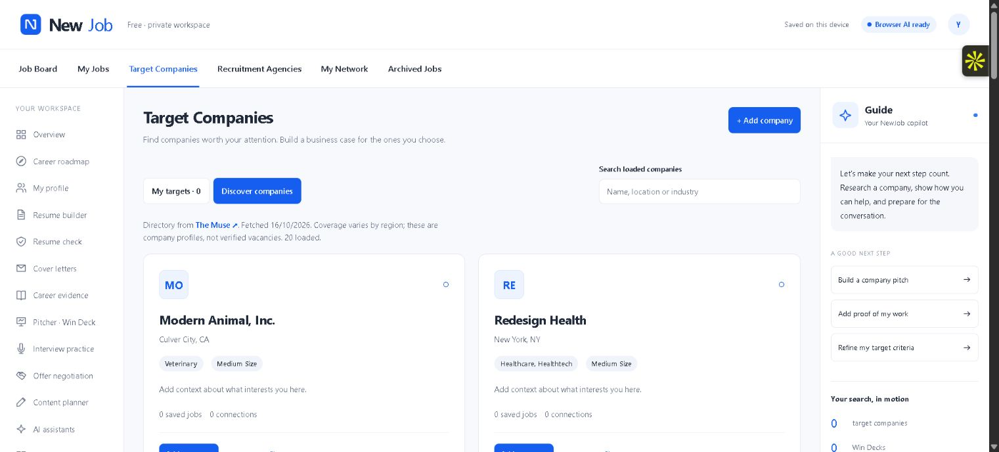

<div align="center">

# NewJob

### Research the company. Show your value. Prepare for the offer.

A free career workspace with private AI, company research, editable Win Decks and negotiation practice.

[](https://github.com/Pratikrishi97/newjob/actions/workflows/ci.yml)
[](LICENSE)
[](https://nodejs.org/)
[](https://ollama.com/)

[Open NewJob — free](https://newjob-career.netlify.app) · [Quick start](#quick-start) · [User guide](docs/USAGE.md) · [Feature audit](FEATURES.md) · [Verification](docs/VERIFICATION.md) · [Contribute](CONTRIBUTING.md)

</div>



_Actual application screenshot showing the public company directory. Your private workspace starts empty._

NewJob connects career evidence, company research, applications, pitches and offer preparation. The hosted edition stores your work in your browser and uses optional WebGPU AI. The desktop edition uses SQLite and Ollama. Resume editing, tracking, deck editing and negotiation worksheets work without AI. No paid API key or app subscription is required.

**Hosted first steps:** open Settings → Load free AI model. Browser AI needs WebGPU, roughly 1 GB of downloads and sufficient graphics memory. Export a backup before clearing browser storage. See [the expanded workflow guide](docs/WORKFLOWS.md) and [hosting details](docs/DEPLOYMENT.md).

## What you can do

- **Build a resume:** local PDF/DOCX/TXT import, review detected sections, edit real experience, choose a template, accent and spacing, and export text or print to PDF.
- **Improve an application:** compare resume text with a job description, inspect missing keywords and draft a cover letter.
- **Research target companies:** browse a public directory, read company sources and news headlines, and identify problem hypotheses with matching source quotes.
- **Build a Win Deck:** connect a problem, career stories, a saved job and images. Edit slides and notes; export editable PowerPoint or standalone HTML.
- **Learn negotiation:** five teaching modules, offer comparison, four practice rounds, AI feedback and a transparent wording checklist.
- **Keep the search organized:** sourced remote jobs, five-stage pipeline, contacts, follow-up dates, career roadmaps and a post planner.
- **Practice and prepare:** use nine assistants for strategy, search queries, tailoring, networking, pitch outlines, LinkedIn drafts, interviews and negotiation.
- **Keep control of your data:** local SQLite or browser IndexedDB, portable JSON backups and no cloud account.

## Quick start

Install [Node.js 22.13+](https://nodejs.org/) and, for AI, [Ollama](https://ollama.com/). Then:

```sh
git clone https://github.com/Pratikrishi97/newjob.git
cd newjob
npm ci
ollama pull qwen2.5:3b
npm start
```

Open **http://127.0.0.1:4317**. Start Ollama if Settings reports it offline. Model downloads are separate from app installation. Start with 3B on modest hardware; larger models use more memory and can improve answers.

**Windows:** after downloading the source, double-click `Start NewJob.cmd`. It installs missing app dependencies and opens the workspace. You still need Node.js and, for AI, an installed Ollama model.

**First five minutes:** Profile → Resume builder → Resume check → save an opportunity → practice one interview question. The [user guide](docs/USAGE.md) explains each tool, backups, exports and troubleshooting.

## What “free and local” means

| Runs on your device                              | Uses the internet                             |
| ------------------------------------------------ | --------------------------------------------- |
| Resume parsing, checking and presentation export | Initial app/model downloads                   |
| SQLite or IndexedDB records and JSON backups     | Public company and Remotive job feeds         |
| AI prompts through Ollama or browser WebGPU      | Selected public URLs and company/news queries |
| Pasted research notes                            | Links you choose to open                      |

No resume or prompt is sent to NxtJob, OpenAI or Remotive. Local inference uses your hardware, storage and electricity. Cloud-tagged models are excluded. Model licenses and hardware requirements still apply.

The desktop server binds to `127.0.0.1`; do not expose it as a shared server. The hosted edition uses browser storage and has no workspace database on the server. Back up through Settings before clearing browser data. Personal data in `data/` is excluded from Git. Hosting and model providers receive ordinary connection metadata. Free hosting has usage limits.

## Honest boundaries

NewJob is an independent implementation inspired by publicly described career workflows. It is **not a complete NxtJob replica**, and is not affiliated with NxtJob. The [feature-by-feature audit](FEATURES.md) distinguishes implemented tools from missing capabilities.

The resume score is a text heuristic, not an employer ATS result. Research proposes hypotheses, not certified company problems. Interviews use text; negotiation also offers local prompt readout when available. No automatic messages, publishing, applications, private contact database, live salary database, human coaching, voice/video scoring or cloud sync. AI drafts require review.

Job listings are attributed to [Remotive](https://remotive.com/), link to the source, are delayed by 24 hours and cached for six hours. Availability and coverage depend on the external feed.

## Built to be understandable

JavaScript modules + CSS, Node HTTP/SQLite, PDF.js, Mammoth, PptxGenJS, WebLLM and Ollama. The hosted build uses Netlify functions for public data only; no paid model service is required.

```sh
npm test              # isolated API + core tests; no model required
npm run check         # syntax and formatting
npm audit             # current dependency advisories
npm run build         # hosted browser app in dist/
```

See [architecture](docs/ARCHITECTURE.md), [verification evidence](docs/VERIFICATION.md), and [research provenance](RESEARCH.md). Optional environment variables: `NEWJOB_PORT` (default `4317`) and `NEWJOB_DATA_DIR` (default `data/`).

## Help shape the next version

Useful contributions include accessible layouts, regional job coverage, model-output evaluation and stronger import fixtures. See [feature coverage](FEATURES.md) and [contribution guide](CONTRIBUTING.md). Use fictional examples in reports. A star helps discovery; GitHub Trending placement cannot be guaranteed.

[MIT license](LICENSE). Third-party packages and models retain their own licenses.
