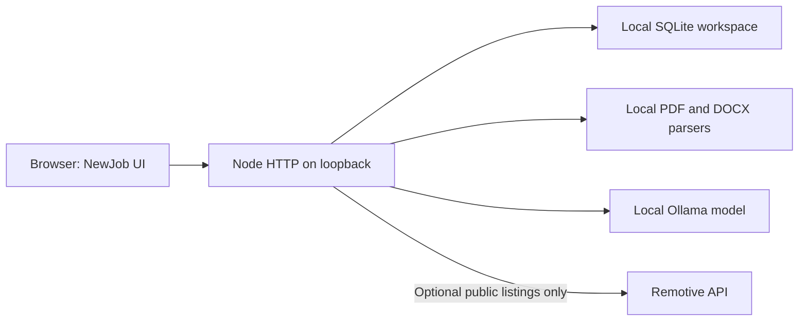

# Architecture

The browser loads ES modules directly from `public/`. Hash routes render a shared sidebar and tool pages. The same pure validation and resume-analysis functions are used by the server and tests.

`GET /api/state` returns the workspace and revision. `PUT /api/state` validates and replaces it only if the revision still matches. Writes are serialized in the browser. A conflict stops further writes until reload, with a backup option. This is optimistic concurrency, not multi-user collaboration.

`POST /api/import` extracts text from a maximum 10 MB document; PDFs are limited to 35 pages. Heading detection in `parseResume` proposes fields for explicit review. It does not invent missing information or perform OCR.

`POST /api/ai` accepts a known assistant, an installed local model and a limited conversation. The server builds the system instruction, sends it to local Ollama and streams NDJSON to the browser. Generation is serialized, can be aborted and times out after four minutes. Models are never downloaded by the app. Cover letters receive profile-only context; assistants receive a bounded workspace summary.

`GET /api/jobs` caches the public Remotive feed for six hours. Source links and attribution are displayed. A stale cache can be served if the provider fails. No resume or profile accompanies this request.

The database uses WAL mode. JSON export is the supported backup path. Schema version 1 migrates missing workflow collections to empty arrays. Saves are capped at 16 MB, original collections at 5,000 records and workflow collections at 500. Each deck supports four PNG/JPG images under 300 KB each. Byte limits can be reached before record limits.

## Hosted edition

The build bundles browser AI, import and presentation export into `dist/`. Private requests use IndexedDB and browser workers. Netlify functions handle public company/job feeds and public-source research only. Pasted notes are removed before the public request and merged locally afterwards. There is no cloud workspace database or model key.

Structured research/deck generation runs through local Ollama on desktop and WebLLM in the browser. Shared cleaners remove citations that do not match saved text. The hosted service rate-limits public requests and reads at most two URLs per research request.

Source fetching enforces HTTPS, rejects private IP destinations and credentials, pins DNS resolution, rechecks redirects and caps response sizes. No telemetry, automatic applications or account actions. REA was a research tool, not a runtime dependency.
